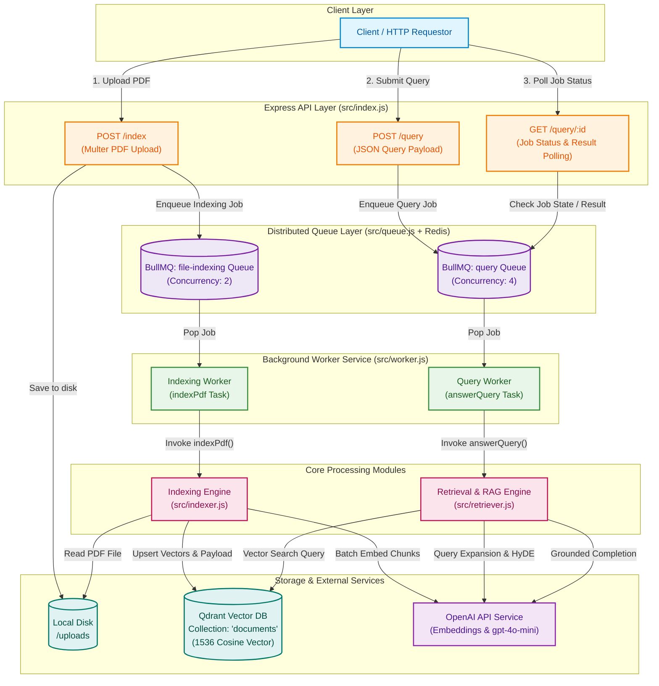
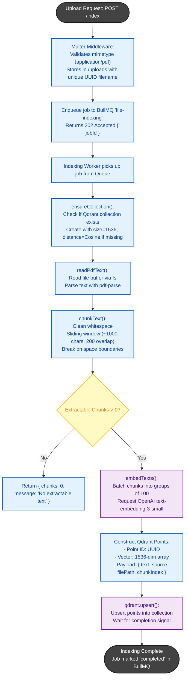
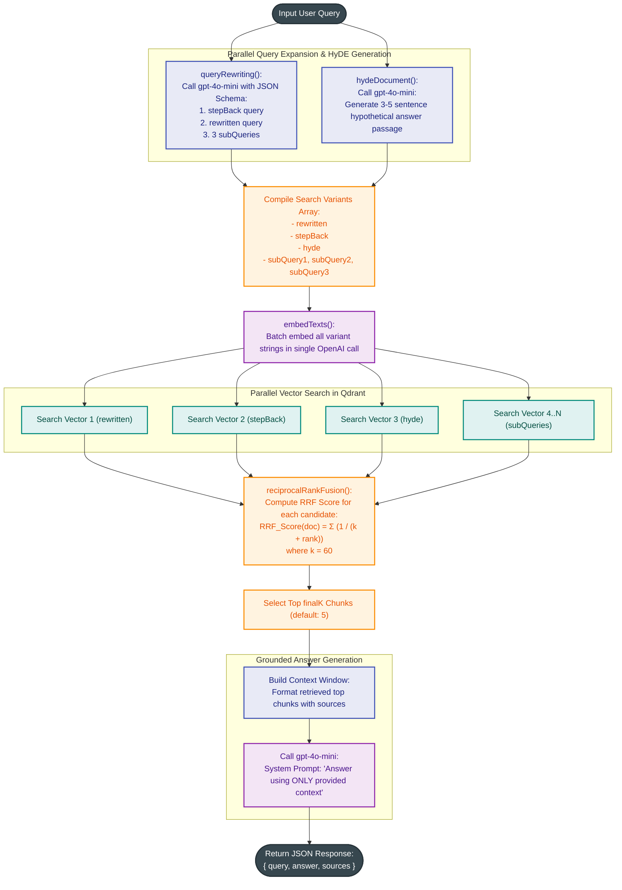
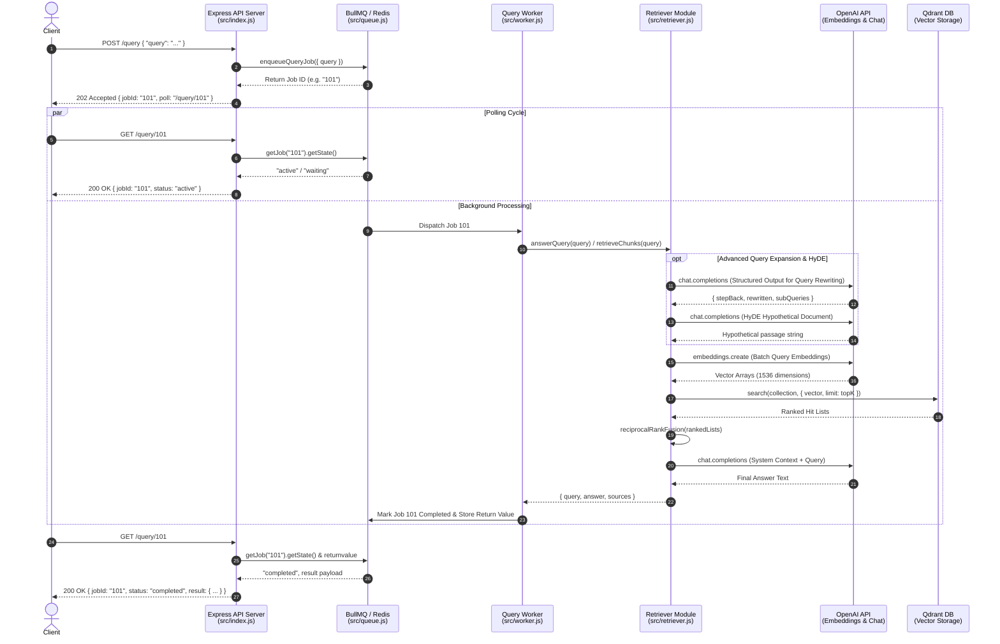

# Advanced RAG Pipeline - Architecture & Workflow Specifications

This document outlines the detailed system architecture, component workflows, data pipelines, and sequence flows for the Advanced Retrieval-Augmented Generation (RAG) system built with **Express**, **BullMQ**, **Redis**, **Qdrant**, and **OpenAI**.

---

## 1. System Architecture Overview

The system is decoupled into an asynchronous job producer/consumer architecture:
- **API Server (`src/index.js`)**: Ingests document uploads and query requests, enqueueing them as background jobs.
- **Message Broker (`src/queue.js`)**: Redis-backed BullMQ queues (`file-indexing` and `query`) for resilient job scheduling and state management.
- **Worker Service (`src/worker.js`)**: Consumes jobs concurrently from Redis to execute heavy text parsing, embedding generation, and vector retrieval tasks.
- **Indexing Engine (`src/indexer.js`)**: Extracts text from PDFs using `pdf-parse`, chunks content with sliding window overlap, embeds text via OpenAI `text-embedding-3-small`, and upserts into Qdrant.
- **Advanced Retrieval Engine (`src/retriever.js`)**: Performs Query Expansion (Step-Back Prompting, Query Rewriting, Sub-Query Decomposition), HyDE (Hypothetical Document Embeddings), parallel multi-query vector searches, and Reciprocal Rank Fusion (RRF).
- **Vector Storage (`src/qdrant.js`)**: Qdrant Vector Database configured for 1536-dimensional Cosine similarity search.
- **LLM / Embedding Services (`src/openai.js`)**: OpenAI API interface for text embeddings and `gpt-4o-mini` chat completions.

---

## 2. High-Level Master System Architecture

The diagram below illustrates the end-to-end component topology, data flows, and external service integrations across the entire pipeline.



---

## 3. Asynchronous PDF Ingestion & Indexing Pipeline

This flowchart outlines the detailed internal sequence when a document is uploaded, chunked, embedded, and indexed into Qdrant.



---

## 4. Advanced Multi-Query & HyDE Retrieval Workflow

The system supports advanced multi-query expansion, HyDE passage generation, parallel vector search, and Reciprocal Rank Fusion (RRF) to maximize retrieval precision and recall.



---

## 5. End-to-End Sequence Diagram (Query Execution & Polling)

This sequence diagram depicts the interaction between the Client, Express API, Redis Queue, Worker Service, Qdrant, and OpenAI during a query request lifecycle.



---

## 6. Source File Responsibilities & Configuration Matrix

| File Path | Primary Responsibility | Key Functions / Exports | Key Dependencies |
| :--- | :--- | :--- | :--- |
| [`src/config.js`](file:///Users/priyanshu/Desktop/ChaiCode/classwork/advance-rag-pipeline/src/config.js) | Centralized system configuration & queue constants | `config`, `INDEXING_QUEUE`, `QUERY_QUEUE` | `dotenv` |
| [`src/index.js`](file:///Users/priyanshu/Desktop/ChaiCode/classwork/advance-rag-pipeline/src/index.js) | Express HTTP API Gateway & file upload handler | `POST /index`, `POST /query`, `GET /query/:id`, `GET /health` | `express`, `multer` |
| [`src/queue.js`](file:///Users/priyanshu/Desktop/ChaiCode/classwork/advance-rag-pipeline/src/queue.js) | BullMQ client connection and job dispatchers | `enqueueIndexingJob()`, `enqueueQueryJob()`, `indexingQueue`, `queryQueue` | `bullmq`, `ioredis` |
| [`src/worker.js`](file:///Users/priyanshu/Desktop/ChaiCode/classwork/advance-rag-pipeline/src/worker.js) | Background job processor for indexing and query execution | `indexingWorker`, `queryWorker` | `bullmq` |
| [`src/indexer.js`](file:///Users/priyanshu/Desktop/ChaiCode/classwork/advance-rag-pipeline/src/indexer.js) | Document parsing, text chunking, and Qdrant ingestion | `indexPdf()`, `chunkText()`, `readPdfText()` | `pdf-parse`, `node:crypto` |
| [`src/retriever.js`](file:///Users/priyanshu/Desktop/ChaiCode/classwork/advance-rag-pipeline/src/retriever.js) | Advanced query expansion, HyDE, RRF fusion, & grounded RAG response | `queryRewriting()`, `hydeDocument()`, `retrieveChunks()`, `answerQuery()` | `openai`, `qdrant` |
| [`src/qdrant.js`](file:///Users/priyanshu/Desktop/ChaiCode/classwork/advance-rag-pipeline/src/qdrant.js) | Qdrant client connection & collection lifecycle management | `qdrant`, `ensureCollection()` | `@qdrant/js-client-rest` |
| [`src/openai.js`](file:///Users/priyanshu/Desktop/ChaiCode/classwork/advance-rag-pipeline/src/openai.js) | Shared OpenAI client & vector embedding helpers | `openai`, `embedText()`, `embedTexts()` | `openai` |

---

## 7. Configuration Parameters & Hyperparameters

Below are the key hyperparameters controlling chunking, vector dimensions, retrieval depth, and Reciprocal Rank Fusion:

```javascript
// Config settings from src/config.js
{
  chunking: {
    chunkSize: 1000,     // Character size per chunk
    chunkOverlap: 200    // Overlapping characters between consecutive chunks
  },
  qdrant: {
    collection: "documents",
    distance: "Cosine",
    dimensions: 1536    // Matches text-embedding-3-small
  },
  retrieval: {
    topK: 4,             // Top candidate chunks per individual query variant
    rrfK: 60,            // Reciprocal Rank Fusion smoothing constant (k)
    finalK: 5            // Final number of chunks passed to LLM context window
  }
}
```
